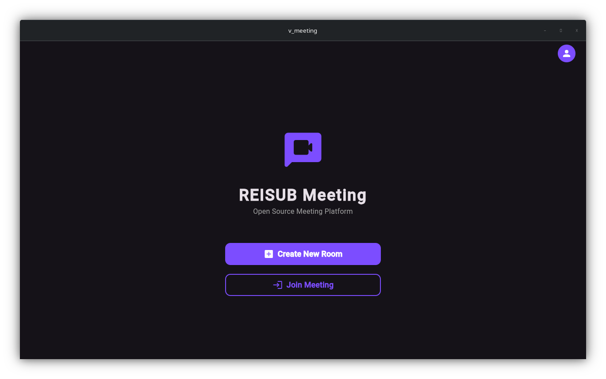
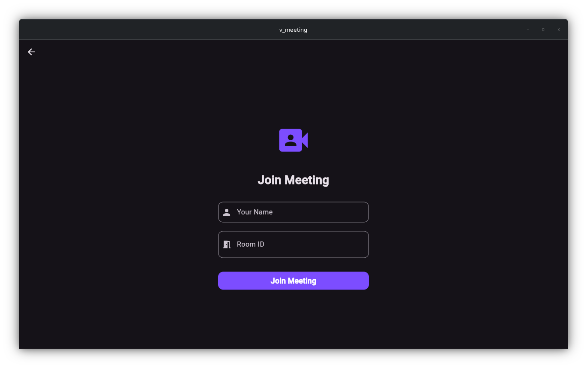
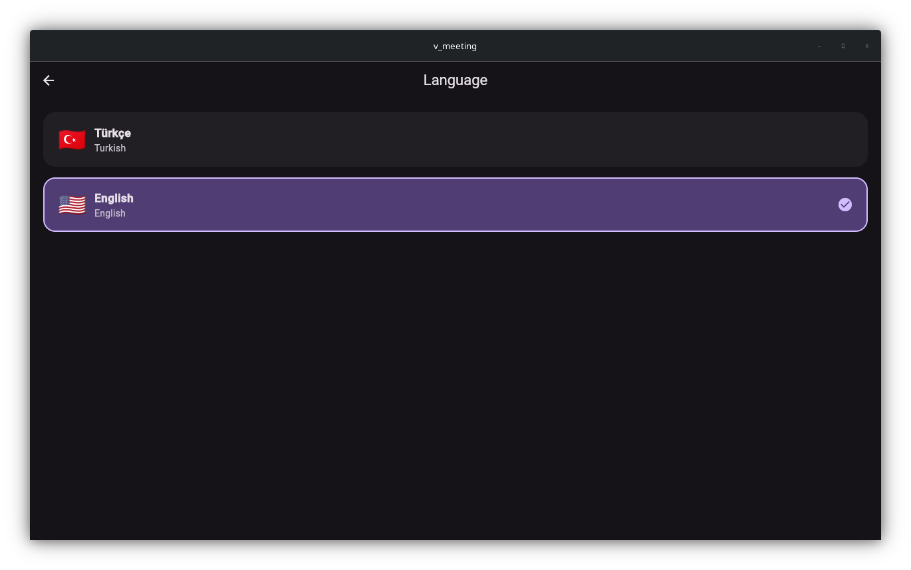
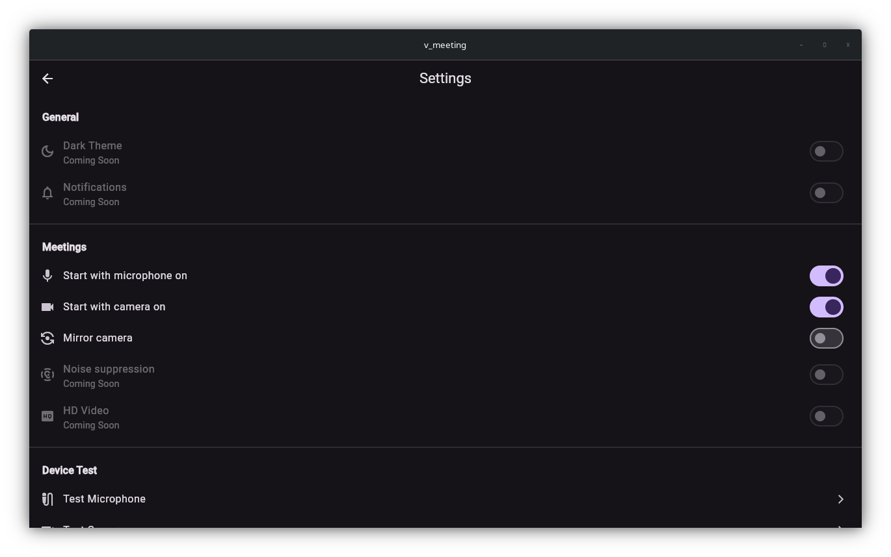
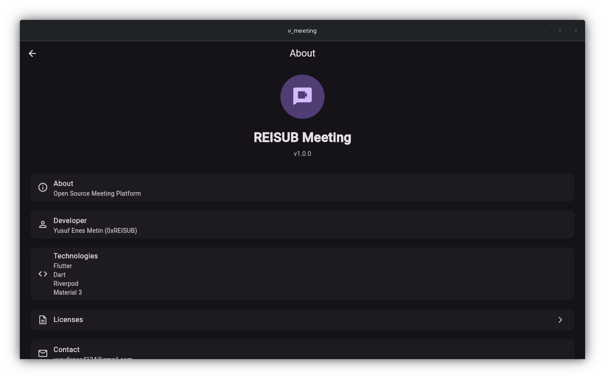

<p align="center">
  
</p>

<h1 align="center">REISUB Meeting</h1>

<p align="center">
  Open-source video meetings, powered by Flutter and LiveKit.<br>
  Flutter ve LiveKit ile açık kaynaklı görüntülü toplantılar.
</p>

<p align="center">
  <a href="#english">English</a> ·
  <a href="#türkçe">Türkçe</a> ·
  <a href="https://github.com/0xREISUB/REISUB_Meeting/releases">Downloads / İndir</a> ·
  <a href="LICENSE">MIT License</a>
</p>

## English

REISUB Meeting connects you to a REISUB Meeting server for video calls,
chat and screen sharing. The application has Windows, Linux, Android and web
clients, with English and Turkish interfaces.

### Features

- **Video meetings:** create a room or join with a nine-digit room code.
- **Speaker view:** see yourself when alone, the other participant in a two-person
  call, and the active speaker in larger meetings.
- **Participant gallery:** view participants and open the member list within the meeting.
- **Chat and screen sharing:** exchange messages and share your screen during a call.
  On desktop, pick a screen or window and optionally share computer audio
  (Windows leaves the meeting's own audio out; on Linux use headphones to avoid
  echo). One person shares at a time, and phones can pinch-zoom a shared screen.
- **Device controls:** choose a microphone or camera, check live audio levels, and
  preview your camera from the meeting settings or application settings.
- **Roles:** full admins and admins can mute and lock microphones, request
  unmuting, allow participant screen sharing and end the meeting for everyone.
  Full admins can also appoint admins and full admins and transfer full admin.
  If the last full admin leaves, an admin (or a random participant) takes over.
- **Invites:** the room code is copied when you open it in a meeting, and
  **Invite** copies a link. The link opens a page to open the meeting in the
  app, or join in the browser. Without the app installed, it leads to the
  download page.
- **No account needed:** you can create and join meetings as a guest. Logging
  in from the profile menu is optional.
- **Server settings:** save your server address and port, including HTTPS connections.
- Public server connections require HTTPS. HTTP is available only for local
  addresses such as `localhost` and private network IPs.

### Download and connect

1. Download the package for your operating system from the
   [Releases page](https://github.com/0xREISUB/REISUB_Meeting/releases).
2. On Windows, extract the entire archive and run **REISUB Meeting.exe**, keeping
   the accompanying files and folders beside it. On Android, install the APK.
3. On first launch, enter the public server details below or your own REISUB
   Meeting server address and port.
4. Create a meeting or join with a room code. Logging in is optional; without
   an account the app uses a guest session.

### Public server

A public REISUB Meeting server is open to everyone until **8 December 2026**.

The web app runs at [https://meeting.reisub.xyz](https://meeting.reisub.xyz) and
needs no installation or server setup: open it in a browser and create or join
a meeting. On phones the Android app is more reliable than a mobile browser.

To use the server from the desktop or Android app, enter these values in the
application's server settings:

| Setting | Value |
| --- | --- |
| Server address | [https://api.meeting.reisub.xyz](https://api.meeting.reisub.xyz) |
| Port | `443` |

A REISUB Meeting server with LiveKit configured is required. The desktop and
mobile downloads contain the client application. Host controls require the
server's moderation and meeting-settings APIs.

For the Linux Debian package, run this command in the folder containing the download:

```sh
sudo apt install ./reisub-meeting_1.1.1-3_amd64.deb
```

The current amd64 package targets Ubuntu 24.04 / Zorin OS 18 libraries. See the
[Linux packaging guide](packaging/linux/README.md) for compatibility and build details.

In a browser, use HTTPS for camera and microphone access outside localhost.

## Türkçe

REISUB Meeting, bir REISUB Meeting sunucusuna bağlanarak görüntülü görüşme,
sohbet ve ekran paylaşımı yapmanızı sağlar. Windows, Linux, Android ve web
istemcilerinde Türkçe ve İngilizce arayüz sunar.

### Özellikler

- **Görüntülü toplantılar:** oda oluşturun veya dokuz haneli oda koduyla katılın.
- **Konuşmacı görünümü:** yalnızken kendinizi, iki kişilik görüşmede karşı tarafı,
  daha kalabalık toplantılarda konuşan kişiyi görün.
- **Katılımcı galerisi:** katılımcıları görüntüleyin ve toplantı içinden kişi listesini açın.
- **Sohbet ve ekran paylaşımı:** görüşme sırasında mesajlaşın ve ekranınızı paylaşın.
  Masaüstünde ekran veya pencere seçip isterseniz bilgisayar sesini de
  paylaşabilirsiniz (Windows toplantının kendi sesini dışarıda bırakır; Linux'ta
  yankı olmaması için kulaklık kullanın). Aynı anda tek kişi paylaşır; telefonda
  paylaşılan ekran iki parmakla yakınlaştırılabilir.
- **Cihaz kontrolleri:** toplantı veya uygulama ayarlarından mikrofon ve kamera
  seçin, canlı ses seviyesini kontrol edin ve kamera önizlemesini açın.
- **Roller:** tam yöneticiler ve yöneticiler mikrofonları kapatıp kilitleyebilir,
  mikrofon açma isteği gönderebilir, katılımcıların ekran paylaşımına izin
  verebilir ve toplantıyı herkes için bitirebilir. Mikrofon açma isteği
  katılımcının onayını gerektirir. Tam yöneticiler ayrıca yönetici ve tam
  yönetici atayabilir, tam yöneticiliği devredebilir. Son tam yönetici ayrılırsa
  yerine bir yönetici (yoksa rastgele bir katılımcı) geçer.
- **Davetler:** toplantıda oda kodunu açtığınızda kod panoya kopyalanır,
  **Davet et** bir bağlantı kopyalar. Bağlantı; toplantıyı uygulamada açma ve
  tarayıcıda katılma seçeneklerini sunan bir sayfa açar. Uygulama yüklü
  değilse indirme sayfasına yönlendirir.
- **Hesap gerekmez:** misafir olarak toplantı oluşturup katılabilirsiniz. Profil
  menüsünden giriş yapmak isteğe bağlıdır.
- **Sunucu ayarları:** HTTPS desteğiyle sunucu adresinizi ve portunuzu kaydedin.
- Herkese açık sunucu bağlantılarında HTTPS gerekir. HTTP yalnızca `localhost`
  ve özel ağ IP adresleri gibi yerel adreslerde kullanılabilir.

### İndirme ve bağlantı

1. [Releases sayfasından](https://github.com/0xREISUB/REISUB_Meeting/releases)
   işletim sisteminize uygun paketi indirin.
2. Windows'ta arşivin tamamını çıkarıp **REISUB Meeting.exe** dosyasını açın;
   diğer dosya ve klasörleri yanında tutun. Android'de APK dosyasını yükleyin.
3. İlk açılışta aşağıdaki herkese açık sunucu bilgilerini veya kendi REISUB
   Meeting sunucunuzun adresini ve portunu girin.
4. Toplantı oluşturun ya da oda koduyla katılın. Giriş yapmak isteğe bağlıdır;
   hesap olmadan uygulama misafir oturumu kullanır.

### Herkese açık sunucu

REISUB Meeting sunucusu **8 Aralık 2026** tarihine kadar herkesin kullanımına
açıktır.

Web uygulaması [https://meeting.reisub.xyz](https://meeting.reisub.xyz)
adresinde çalışır. Kurulum ya da sunucu ayarı gerektirmez: tarayıcıda açıp
toplantı oluşturabilir veya katılabilirsiniz. Telefonlarda Android uygulaması
mobil tarayıcıdan daha kararlı çalışır.

Sunucuyu masaüstü ya da Android uygulamasından kullanmak için uygulamanın sunucu
ayarlarına şu bilgileri girin:

| Ayar | Değer |
| --- | --- |
| Sunucu adresi | [https://api.meeting.reisub.xyz](https://api.meeting.reisub.xyz) |
| Port | `443` |

LiveKit yapılandırması tamamlanmış bir REISUB Meeting sunucusu gerekir. Masaüstü
ve mobil indirmeler istemci uygulamasını içerir. Yönetici kontrolleri için
sunucunun moderasyon ve toplantı ayarları API'leri gereklidir.

Linux Debian paketini indirdiğiniz klasörde şu komutla kurabilirsiniz:

```sh
sudo apt install ./reisub-meeting_1.1.1-3_amd64.deb
```

Mevcut amd64 paketi Ubuntu 24.04 / Zorin OS 18 kütüphanelerini kullanır. Uyumluluk
ve paket oluşturma ayrıntıları için [Linux paketleme rehberine](packaging/linux/README.md) bakın.

Tarayıcıda localhost dışındaki bağlantılarda kamera ve mikrofon için HTTPS kullanın.

## Build from source / Kaynak koddan çalıştırma

Use a Flutter SDK compatible with Dart 3.12 or later and the build tools for your
target platform. Dart 3.12 veya üzeriyle uyumlu bir Flutter SDK'sı ve hedef
platformunuzun derleme araçları gereklidir.

```sh
git clone https://github.com/0xREISUB/REISUB_Meeting.git
cd REISUB_Meeting
flutter pub get
flutter run
```

| Target / Hedef | Build command / Derleme komutu |
| --- | --- |
| Windows | `flutter build windows --release` |
| Linux | `flutter build linux --release` |
| Android | `flutter build apk --release` |
| Web | `python3 tool/build_web.py` |
| Linux `.deb` | `python3 tool/package_deb.py` after the Linux build / Linux derlemesinden sonra |

### Configuration / Yapılandırma

Build settings live in two files in the repository root. Environment variables
override both. / Derleme ayarları depo kökündeki iki dosyada durur; ortam
değişkenleri ikisini de geçersiz kılar.

| File / Dosya | Committed / Depoda | Contents / İçerik |
| --- | --- | --- |
| `app.env` | yes / evet | Public settings: invite host, download and project links, web server. / Herkese açık ayarlar: davet alan adı, indirme ve proje bağlantıları, web sunucusu. |
| `.env` | no / hayır | Local overrides and secrets such as Android signing; copy `.env.example`. / Yerel ayarlar ve Android imzası gibi gizli bilgiler; `.env.example` dosyasını kopyalayın. |

| Key / Anahtar | Used by / Kullanan | Meaning / Anlamı |
| --- | --- | --- |
| `REISUB_INVITE_HOST` | Android | Host serving the web app and `https://<host>/j/<code>` invite links, which open in the app. / Web uygulamasını ve uygulamada açılan `https://<host>/j/<kod>` davet bağlantılarını yayınlayan alan adı. |
| `REISUB_SERVER_URL` | invite page, Android / davet sayfası, Android | Server address users enter in the app (e.g. `https://api.meeting.reisub.xyz`); invites opened in the app use it. / Kullanıcıların uygulamaya girdiği sunucu adresi (örn. `https://api.meeting.reisub.xyz`); uygulamada açılan davetler bunu kullanır. |
| `REISUB_DOWNLOAD_URL` | invite page / davet sayfası | Where the invite page sends people without the app. / Davet sayfasının uygulaması olmayanları yönlendirdiği indirme sayfası. |
| `REISUB_SOURCE_URL` | invite page, `.deb` | Project page. / Proje sayfası. |
| `REISUB_WEB_SERVER_URL` | web | Server for the web app when the web app's origin does not also serve the API (needs CORS); empty otherwise. / Web uygulamasının adresi API'yi de sunmuyorsa web'in kullanacağı sunucu (CORS gerekir); aksi halde boş. |
| `REISUB_ANDROID_KEYSTORE`, `REISUB_ANDROID_STORE_PASSWORD`, `REISUB_ANDROID_KEY_ALIAS`, `REISUB_ANDROID_KEY_PASSWORD` | Android release | Signing keystore and passwords; put them in `.env` or the environment. / İmza anahtarı ve şifreleri; `.env` dosyasına ya da ortam değişkenlerine yazın. |

Android release builds fail without the signing settings. Never commit the
keystore or its passwords, and keep a backup: without the same key, installed
apps cannot be updated. / Android sürüm derlemeleri imza ayarları olmadan
başarısız olur. Anahtarı ve şifrelerini asla depoya eklemeyin ve yedekleyin;
aynı anahtar olmadan kurulu uygulamalar güncellenemez.

### Web app and invites / Web uygulaması ve davetler

Build the web app with `python3 tool/build_web.py`: it runs
`flutter build web --release` and fills the invite page
(`build/web/invite/index.html`) from `app.env`. A plain `flutter build web`
also works, but the invite page then hides its download and project links.
Serve `build/web` from the meeting server (see the server's README). /
Web uygulamasını `python3 tool/build_web.py` ile derleyin: araç
`flutter build web --release` çalıştırır ve davet sayfasını `app.env`'deki
değerlerle doldurur. Düz `flutter build web` de çalışır ama davet sayfası
indirme ve proje bağlantılarını gizler. `build/web` klasörünü toplantı
sunucusundan yayınlayın (sunucunun README'sine bakın).

Invite links have the form `https://<host>/j/<room-code>`. "Open in app" uses
`reisub-meeting://join/<room-code>?server=<server-url>`, so the app also learns
which server to use; switching to a different server always asks first. /
Davet bağlantıları `https://<alan-adı>/j/<oda-kodu>` biçimindedir. "Uygulamada
aç", `reisub-meeting://join/<oda-kodu>?server=<sunucu-adresi>` bağlantısını
kullanır; böylece uygulama hangi sunucuya bağlanacağını da öğrenir. Başka bir
sunucuya geçmeden önce her zaman sorulur.

| Platform | How links reach the app / Bağlantılar uygulamaya nasıl ulaşır |
| --- | --- |
| Android | Invite links on `REISUB_INVITE_HOST` open directly once the server publishes `/.well-known/assetlinks.json` with the signing key's SHA-256 fingerprint; the invite page's "Open in app" works either way. / Sunucu, imza anahtarının SHA-256 parmak iziyle `/.well-known/assetlinks.json` yayınladığında `REISUB_INVITE_HOST` üzerindeki davetler doğrudan açılır; davet sayfasındaki "Uygulamada aç" her durumda çalışır. |
| Windows | The app registers `reisub-meeting://` for the current user on every start. / Uygulama her açılışta `reisub-meeting://` şemasını mevcut kullanıcı için kaydeder. |
| Linux (`.deb`) | The package's desktop entry registers `reisub-meeting://`. / Paketin masaüstü dosyası `reisub-meeting://` şemasını kaydeder. |

Print a keystore's fingerprint with / Anahtarın parmak izini görmek için:

```sh
keytool -list -v -keystore <keystore.jks> | grep SHA256
```

## Screenshots / Ekran görüntüleri

| Home / Ana sayfa | Join / Toplantıya katıl |
| --- | --- |
|  |  |

| Language / Dil | Settings / Ayarlar |
| --- | --- |
|  |  |

| About / Hakkında |
| --- |
|  |

## Contributing / Katkıda bulunma

Bug reports, feature suggestions and pull requests are welcome. Share issues
through [GitHub Issues](https://github.com/0xREISUB/REISUB_Meeting/issues).

Hata bildirimlerinizi, özellik önerilerinizi ve pull request'lerinizi bekliyoruz.
Sorunları [GitHub Issues](https://github.com/0xREISUB/REISUB_Meeting/issues)
üzerinden paylaşabilirsiniz.

## License / Lisans

REISUB Meeting is licensed under the [MIT License](LICENSE).
REISUB Meeting, [MIT Lisansı](LICENSE) ile sunulmaktadır.
