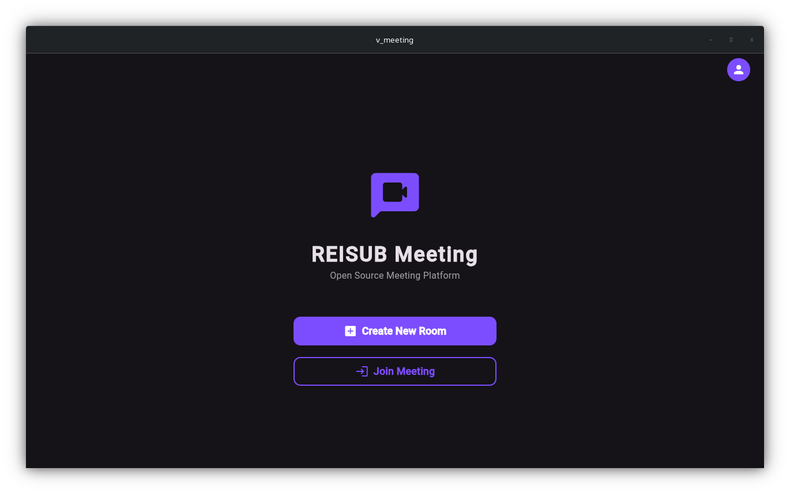
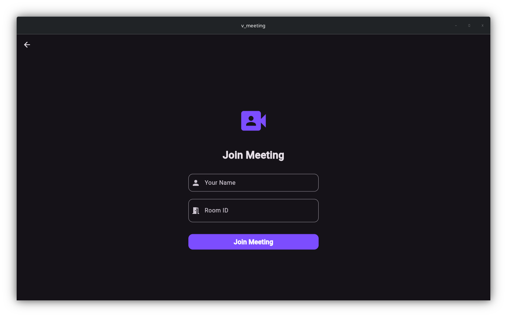
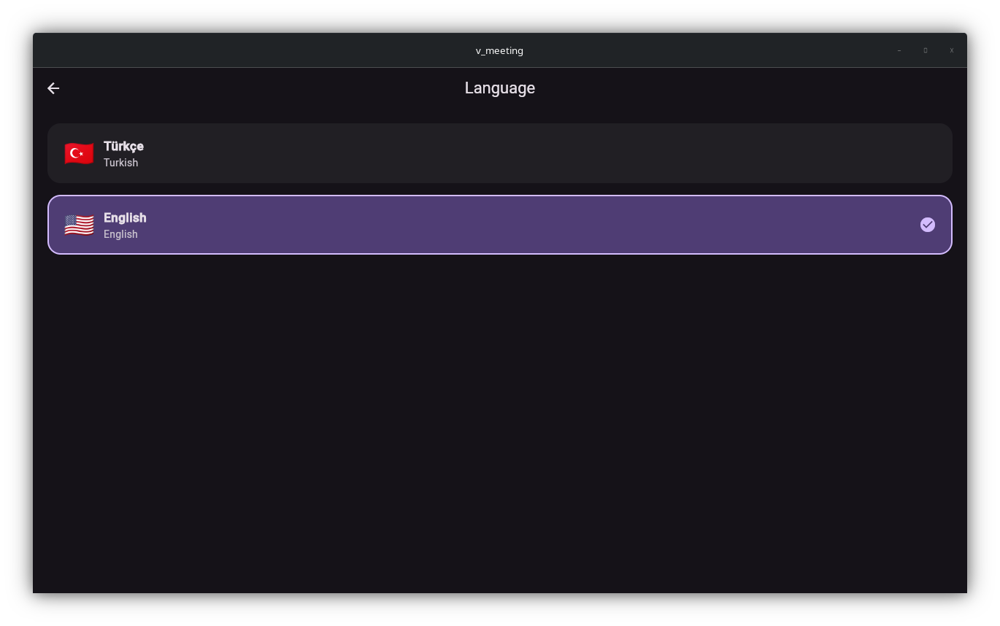
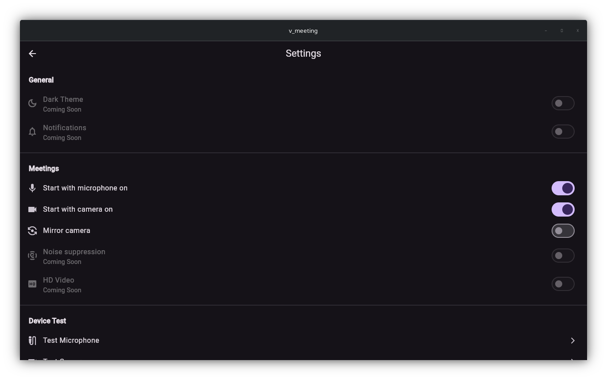
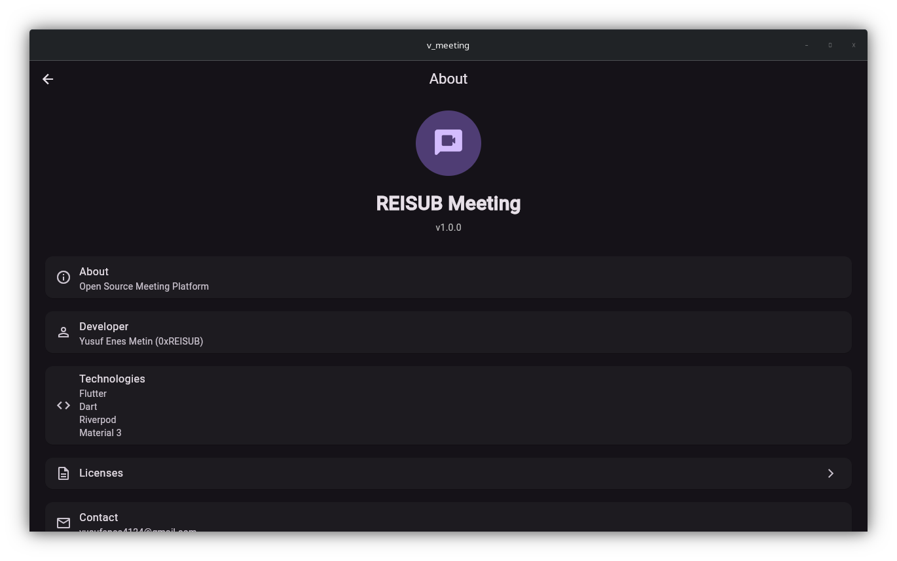

<p align="center">
  
</p>

<h1 align="center">REISUB Meeting</h1>

<p align="center">
  Open-source video meetings, powered by Flutter and LiveKit.<br>
  Flutter ve LiveKit ile açık kaynaklı görüntülü toplantılar.
</p>

<p align="center">
  <a href="#english">English</a> ·
  <a href="#türkçe">Türkçe</a> ·
  <a href="https://github.com/0xREISUB/REISUB_Meeting/releases">Downloads / İndir</a> ·
  <a href="LICENSE">MIT License</a>
</p>

## English

REISUB Meeting connects you to your own REISUB Meeting server for video calls,
chat and screen sharing. The application has Windows, Linux, Android and web
clients, with English and Turkish interfaces.

### Features

- **Video meetings:** create a room or join with a nine-digit room code.
- **Speaker view:** see yourself when alone, the other participant in a two-person
  call, and the active speaker in larger meetings.
- **Participant gallery:** view participants and open the member list within the meeting.
- **Chat and screen sharing:** exchange messages and share your screen during a call.
- **Device controls:** choose a microphone or camera, check live audio levels, and
  preview your camera from the meeting settings or application settings.
- **Host controls:** mute and lock participant microphones, request permission to
  unmute, manage screen-sharing permissions, and end a meeting for everyone.
- **Server settings:** save your server address and port, including HTTPS connections.

### Download and connect

1. Download the package for your operating system from the
   [Releases page](https://github.com/0xREISUB/REISUB_Meeting/releases).
2. On Windows, extract the entire archive and run **REISUB Meeting.exe**, keeping
   the accompanying files and folders beside it. On Android, install the APK.
3. On first launch, enter your REISUB Meeting server address and port.
4. Sign in or create an account, then create a meeting or join with a room code.

A REISUB Meeting server with LiveKit configured is required. The desktop and
mobile downloads contain the client application. Host controls require the
server's moderation and meeting-settings APIs.

For the Linux Debian package, run this command in the folder containing the download:

```sh
sudo apt install ./reisub-meeting_1.0.0-1_amd64.deb
```

The current amd64 package targets Ubuntu 24.04 / Zorin OS 18 libraries. See the
[Linux packaging guide](packaging/linux/README.md) for compatibility and build details.

In a browser, use HTTPS for camera and microphone access outside localhost.

## Türkçe

REISUB Meeting, kendi REISUB Meeting sunucunuza bağlanarak görüntülü görüşme,
sohbet ve ekran paylaşımı yapmanızı sağlar. Windows, Linux, Android ve web
istemcilerinde Türkçe ve İngilizce arayüz sunar.

### Özellikler

- **Görüntülü toplantılar:** oda oluşturun veya dokuz haneli oda koduyla katılın.
- **Konuşmacı görünümü:** yalnızken kendinizi, iki kişilik görüşmede karşı tarafı,
  daha kalabalık toplantılarda konuşan kişiyi görün.
- **Katılımcı galerisi:** katılımcıları görüntüleyin ve toplantı içinden kişi listesini açın.
- **Sohbet ve ekran paylaşımı:** görüşme sırasında mesajlaşın ve ekranınızı paylaşın.
- **Cihaz kontrolleri:** toplantı veya uygulama ayarlarından mikrofon ve kamera
  seçin, canlı ses seviyesini kontrol edin ve kamera önizlemesini açın.
- **Yönetici kontrolleri:** katılımcı mikrofonlarını kapatıp kilitleyin, mikrofon
  açma isteği gönderin, ekran paylaşımı izinlerini yönetin ve toplantıyı herkes
  için bitirin. Mikrofon açma isteği katılımcının onayını gerektirir.
- **Sunucu ayarları:** HTTPS desteğiyle sunucu adresinizi ve portunuzu kaydedin.

### İndirme ve bağlantı

1. [Releases sayfasından](https://github.com/0xREISUB/REISUB_Meeting/releases)
   işletim sisteminize uygun paketi indirin.
2. Windows'ta arşivin tamamını çıkarıp **REISUB Meeting.exe** dosyasını açın;
   diğer dosya ve klasörleri yanında tutun. Android'de APK dosyasını yükleyin.
3. İlk açılışta REISUB Meeting sunucunuzun adresini ve portunu girin.
4. Giriş yapın veya hesap oluşturun; ardından toplantı oluşturun ya da oda koduyla katılın.

LiveKit yapılandırması tamamlanmış bir REISUB Meeting sunucusu gerekir. Masaüstü
ve mobil indirmeler istemci uygulamasını içerir. Yönetici kontrolleri için
sunucunun moderasyon ve toplantı ayarları API'leri gereklidir.

Linux Debian paketini indirdiğiniz klasörde şu komutla kurabilirsiniz:

```sh
sudo apt install ./reisub-meeting_1.0.0-1_amd64.deb
```

Mevcut amd64 paketi Ubuntu 24.04 / Zorin OS 18 kütüphanelerini kullanır. Uyumluluk
ve paket oluşturma ayrıntıları için [Linux paketleme rehberine](packaging/linux/README.md) bakın.

Tarayıcıda localhost dışındaki bağlantılarda kamera ve mikrofon için HTTPS kullanın.

## Build from source / Kaynak koddan çalıştırma

Use a Flutter SDK compatible with Dart 3.12 or later and the build tools for your
target platform. Dart 3.12 veya üzeriyle uyumlu bir Flutter SDK'sı ve hedef
platformunuzun derleme araçları gereklidir.

```sh
git clone https://github.com/0xREISUB/REISUB_Meeting.git
cd REISUB_Meeting
flutter pub get
flutter run
```

| Target / Hedef | Build command / Derleme komutu |
| --- | --- |
| Windows | `flutter build windows --release` |
| Linux | `flutter build linux --release` |
| Android | `flutter build apk --release` |
| Web | `flutter build web --release` |
| Linux `.deb` | `python3 tool/package_deb.py` after the Linux build / Linux derlemesinden sonra |

## Screenshots / Ekran görüntüleri

| Home / Ana sayfa | Join / Toplantıya katıl |
| --- | --- |
|  |  |

| Language / Dil | Settings / Ayarlar |
| --- | --- |
|  |  |

| About / Hakkında |
| --- |
|  |

## Contributing / Katkıda bulunma

Bug reports, feature suggestions and pull requests are welcome. Share issues
through [GitHub Issues](https://github.com/0xREISUB/REISUB_Meeting/issues).

Hata bildirimlerinizi, özellik önerilerinizi ve pull request'lerinizi bekliyoruz.
Sorunları [GitHub Issues](https://github.com/0xREISUB/REISUB_Meeting/issues)
üzerinden paylaşabilirsiniz.

## License / Lisans

REISUB Meeting is licensed under the [MIT License](LICENSE).
REISUB Meeting, [MIT Lisansı](LICENSE) ile sunulmaktadır.
